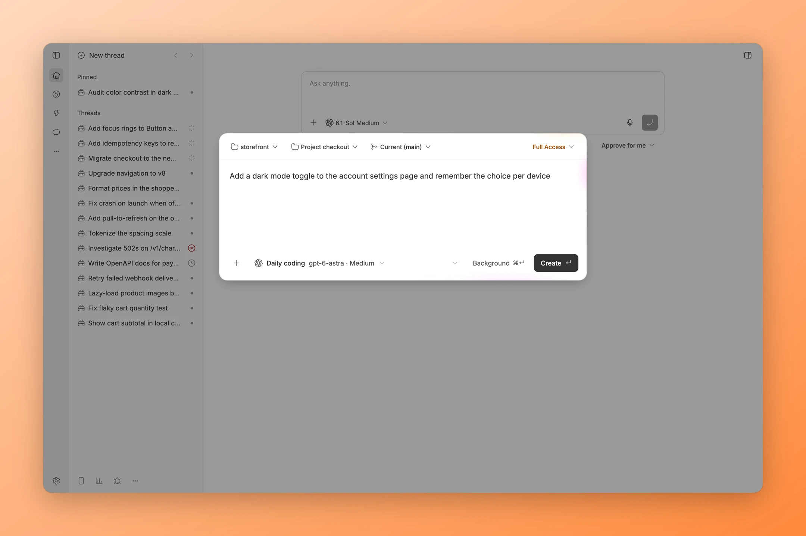
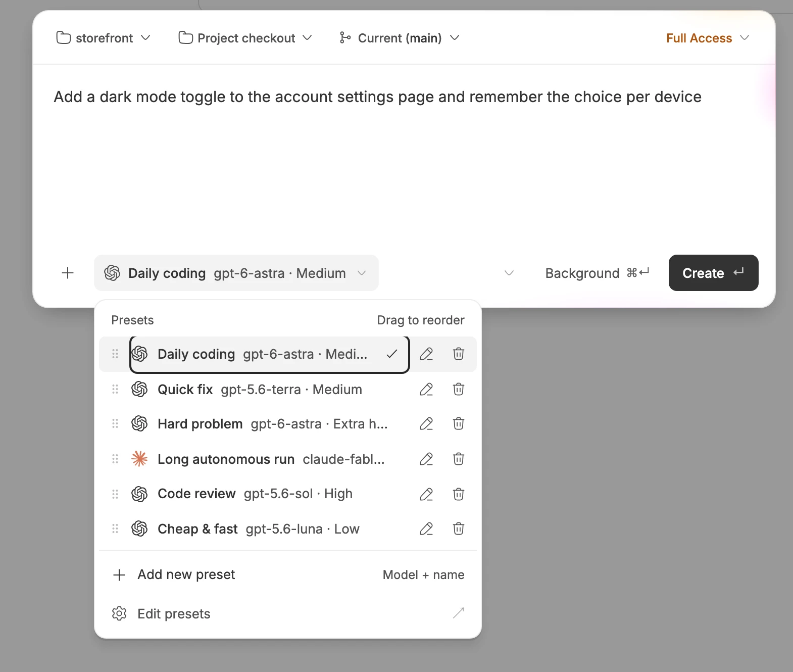
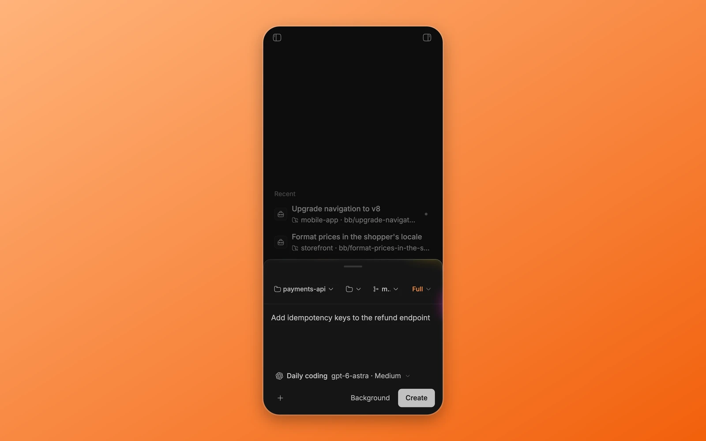

<p align="center">
  
</p>

<h1 align="center">Ultra Launcher</h1>

<p align="center">
  <strong>Start a thread from anywhere in BB.</strong>
</p>

<p align="center">
  <a href="#highlights">Highlights</a> ·
  <a href="#screenshots">Screenshots</a> ·
  <a href="#installation">Installation</a> ·
  <a href="#development">Development</a>
</p>

<p align="center">
  
</p>

Ultra Launcher opens a floating composer on any BB screen with ⌘N (Ctrl+N on Windows and Linux). Choose a project and a saved model preset, write the prompt, and start the thread without leaving the one you are in.

## Highlights

- ⚡ **Start from any screen.** ⌘N opens the launcher over whatever you are doing, and Esc closes it with your draft kept.
- 🎛️ **Presets for each kind of task.** Save up to 30 combinations of provider, model, reasoning level and service tier, and switch with one click.
- 🌙 **Send it to the background.** ⌘↵ creates the thread without opening it and shows a toast with an Open button.
- ✏️ **Edit presets where you use them.** Rename, reorder by dragging, or delete presets in the picker or in settings.
- 📱 **Works on your phone.** On small screens the launcher opens as a bottom sheet.
- 🤖 **Scriptable.** `bb ultra-launcher` lists presets and claims or releases ⌘N from a terminal.

## Screenshots

<p align="center">
  
  
</p>

## Installation

```sh
bb plugin install https://github.com/dillionverma/bb-plugin-ultra-launcher
```

The launcher takes over ⌘N and moves BB's own New thread shortcut to ⌘⇧O. To give ⌘N back, turn off **Take over Ctrl/Cmd+N** in **Settings → Ultra Launcher**, or run `bb ultra-launcher release`. Run `release` before you uninstall.

New installs start with presets for the providers you have. Requires BB 0.46 or later.

## Development

```sh
git clone https://github.com/dillionverma/bb-plugin-ultra-launcher.git
cd bb-plugin-ultra-launcher
npm ci
bb plugin install .
bb plugin dev
```

Run `npm test`, `npm run typecheck` and `bb plugin build` before submitting changes.

## License

[MIT](LICENSE).
